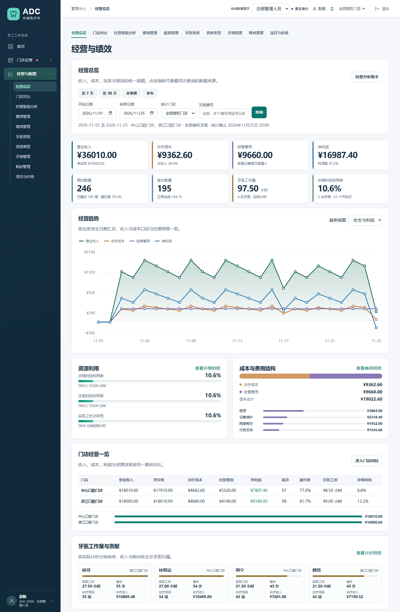
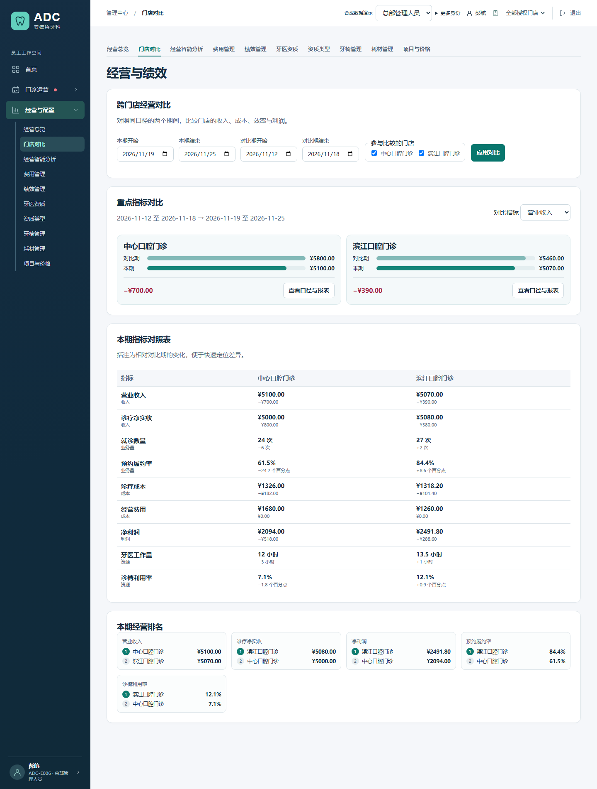
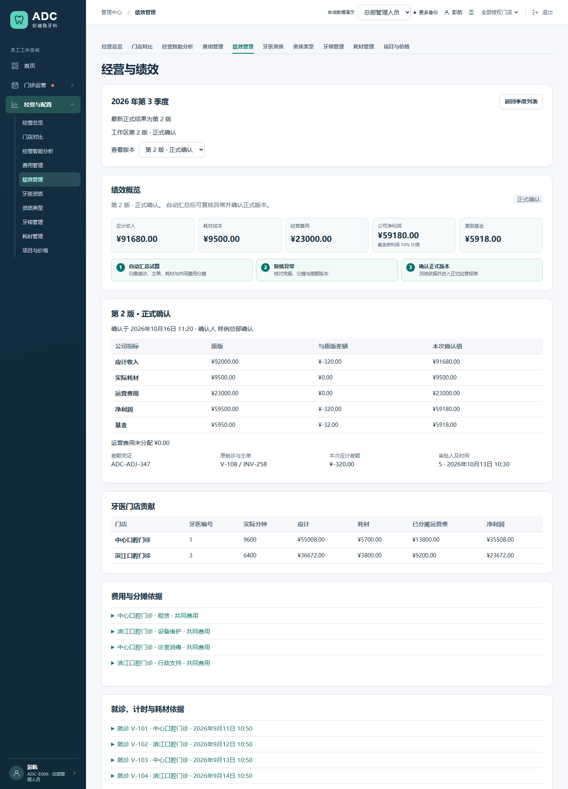
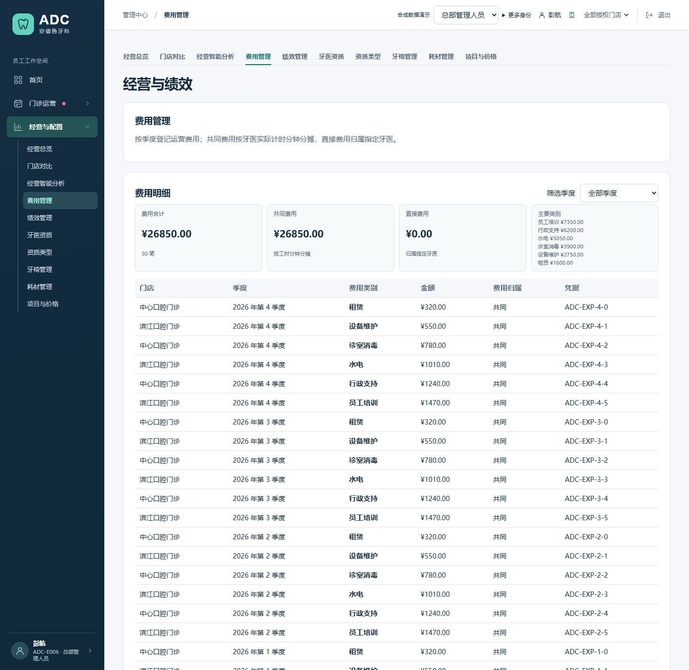
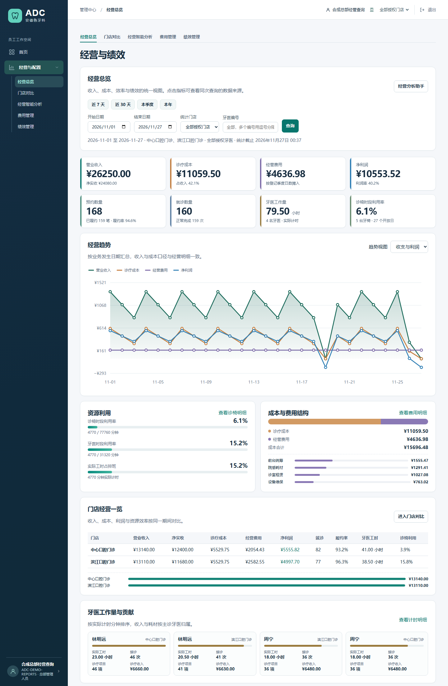

# 任务 07 · 经营与绩效中心验证

日期：2026-11-27

| 界面 | 截图 |
| --- | --- |
| 经营总览（合成演示） |  |
| 门店对比 |  |
| 绩效核算与确认 |  |
| 费用管理 |  |
| 正式模式经营总览（Django + PostgreSQL） |  |

## 指标口径

- 营业收入：已开立主单的应计金额，按就诊结束日期归期。
- 诊疗成本：治疗项目实际耗材用量 × 成本快照。
- 经营费用：季度登记费用按覆盖日数摊入所选期间；绩效核算仍按整季度归集。
- 净利润：营业收入 − 诊疗成本 − 经营费用。
- 牙医工作量：`dentist_work_session` 实际计时分钟。
- 资源利用：已发布班次开放时段 × 可用牙椅计算容量，未取消正式预约的占用时段计为使用。
- 趋势：区间不超过 62 天按日汇总，否则按自然月汇总；指标均可回查同次查询明细。

## 验证结果

- Django：131 项测试通过。
- 前端：22 个测试文件、74 项测试通过。
- 正式构建与演示构建成功。
- 演示地址：<https://dudu131515.github.io/adc-demo/>
- 源码提交：`b2b549c`、`5ee26ca`；静态发布：`af5ba38`。
