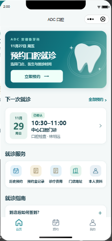
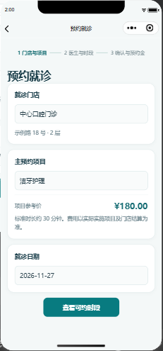
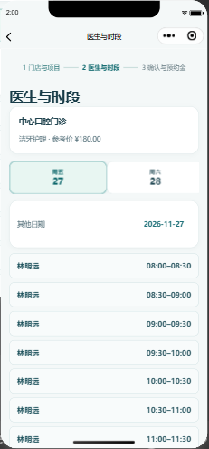
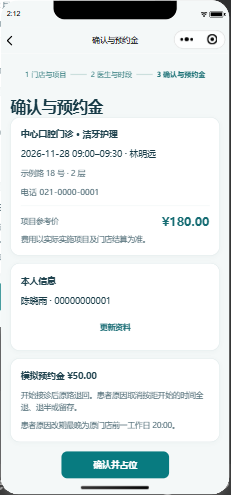
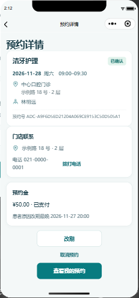
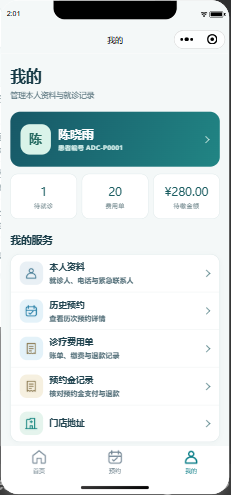
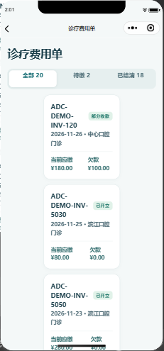

# 任务 08 · 微信原生小程序验证

日期：2026-11-27

| 界面 | 截图 |
| --- | --- |
| 首页（品牌、下一次就诊、服务入口） |  |
| 预约：门店、项目参考价、标准时长 |  |
| 医生与时段：7 天日期条、可约时段 |  |
| 确认预约与模拟预约金 |  |
| 预约成功详情（预约号、门店电话、预约金） |  |
| 我的：待就诊、费用单、待缴金额 |  |
| 诊疗费用单：全部/待缴/已结清 |  |

## 真实联动验证

在微信开发者工具原生模拟器中，以本地合成患者完成：

选择中心门诊 → 洁牙护理（参考价 ¥180.00）→ 2026-11-28 09:00–09:30 → 林明远 → 确认占位 → 模拟支付 ¥50.00。

生成预约号 `ADC-A9F6D5ED21204A069CE9153C50D505A1`，状态 `CONFIRMED`。随后以前台账号 `demo.front-a` 调用管理端预约接口，按 2026-11-28、中心门诊查询到同一预约号，门店、牙医、项目与状态一致。患者端与管理端使用同一 Django/PostgreSQL 数据，不存在小程序本地假预约。

## 测试

- 小程序服务层：`node --test mini-program/tests/*.test.cjs`，17 项通过。
- 后端预约、预约金、改约、取消、费用单相关全量测试通过（共 132 项 Django 测试）。

## 部署事实

- 开发版使用 `http://127.0.0.1:8000/api/v1`，在微信开发者工具勾选本地不校验域名。
- `project.config.json` 中的 AppID 为仓库已有配置，未替换为未核实 AppID。
- 体验版/正式版需要已备案 HTTPS 后端和微信 request 合法域名。当前公网 HTTPS 与网站 ICP 备案尚未完成，因此**不宣称体验版已配置成功**；配置步骤见 [mini-program/README.md](../../mini-program/README.md)。
- 模拟预约金不接入真实微信支付。
