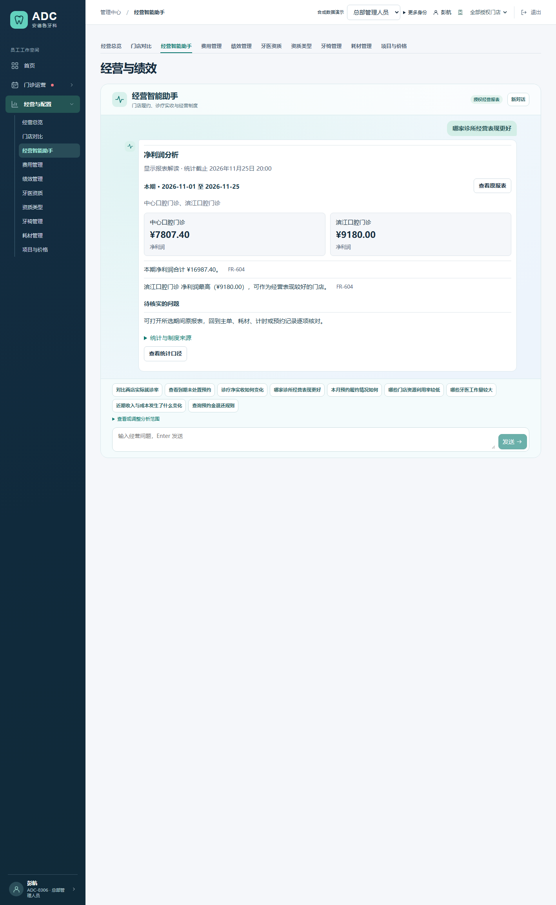

# 任务 09 · 经营智能助手验证

日期：2026-11-27

## 完成能力

助手在原有履约、净实收、制度问答基础上，新增：

- 营业收入、诊疗成本、经营费用、净利润；
- 就诊数量、牙医实际工时、诊椅时段利用率；
- 门店经营表现排序、牙医工作量排序、资源利用率低门店；
- 本期与对比期的收入/成本/费用/利润变化；
- 每个结论标注来源条款，并可打开同次查询的原报表。

可直接提问：

- 哪家诊所经营表现更好？
- 本月预约履约情况如何？
- 哪些门店资源利用率较低？
- 哪些牙医工作量较大？
- 近期收入和成本发生了什么变化？

正式模式使用同一套 Django 经营事实与 DeepSeek 可选接入；演示模式使用合成的门店、收入、成本、工时和利用率数据。默认未配置 DeepSeek 时使用报表解读，不伪造模型结果。

## 截图

演示结果示例：本期净利润合计 ¥16,987.40，滨江门诊 ¥9,180.00 最高；助手给出经营表现较好的门店并标注 FR-604。正式库示例中，净利润合计 ¥10,553.52，中央/滨江分别为 ¥5,555.82 / ¥4,997.70。

## 测试

- 后端助手契约测试 17 项通过，覆盖建议数量、权限、两周对比、经营问答和来源回查。
- 全量 Django 测试 132 项通过。
- 前端 22 个测试文件、74 项通过；正式和演示构建通过。
