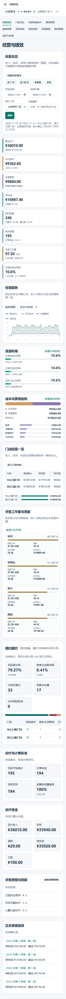

# 任务 10 · 整体体验与最终交付

日期：2026-11-27

## 本轮收尾

- 统一经营工作区命名：经营总览、门店对比、经营智能助手、费用管理、绩效管理。
- 管理端 390px 窄屏顶部栏改为可换行，工作区宽度与页面滚动宽度一致（实测 `scrollWidth = innerWidth = 390`，无横向溢出）。
- 经营总览、门店对比、绩效详情、费用管理、助手对话保持同一视觉语言。
- 小程序首页、预约、时段、确认、详情、我的、费用单使用统一卡片和状态样式。
- 演示网站重新构建并发布。

## 端到端业务链

患者小程序选择门店 → 项目（参考价与时长）→ 牙医和时段 → 确认 → 模拟预约金 → 预约成功  
→ 管理端前台按同店同日查询到同一预约号（`ADC-A9F6D5ED21204A069CE9153C50D505A1`，`CONFIRMED`）  
→ 前台签到分椅 → 牙医接诊/记录治疗 → 前台开单与模拟收款 → 患者端费用单查询  
→ 总部经营总览、门店对比、绩效管理核对。

原有 01–07 的排班、患者、诊疗、结算、经营和绩效流程未被重写。

## 测试与构建

- Django：132 项通过。
- 小程序服务层：17 项通过。
- 前端：22 个测试文件、74 项通过。
- `npm run build` 与 `npm run build:demo` 成功。
- 演示：<https://dudu131515.github.io/adc-demo/>

## 已知边界

- 微信体验版/正式版仍需已备案 HTTPS 后端和微信合法域名；当前不宣称已配置。
- 公网部署服务器、域名与备案材料由课程环境决定，仓库未编造这些信息。
