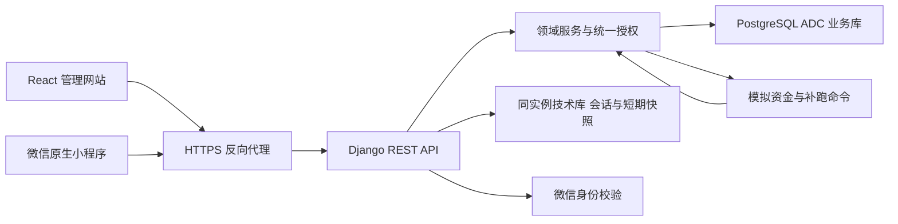

# ADC 完整系统技术设计

**Spec Kit 目标** `001-adc-system` · **日期** 2026-11-22 · **状态** 实施基线

**输入** [系统 Spec](spec.md) · [章程](../../.specify/memory/constitution.md) · [已审核产品及 UI/UX 设计](../../docs/superpowers/specs/2026-11-22-adc-product-ui-design.md) · [业务母本 V1.2](../../usecase/安德鲁牙科连锁系统分析与设计_最终提交版.docx)

已按[批准的 R01–R09](checklists/requirements-review.md#审核汇总)同步资料投影、跨店权限、取消、退款、费用口径与联验。实施启动时落实[设计衔接 D01–D04](tasks.md#设计衔接)，业务规则沿用母本与 Spec。

## Summary

交付一套 ADC 系统，一个 React 管理网站和一个微信原生小程序。两个入口经同一 HTTP JSON API 调用模块化 Django 服务，业务事实和资金写入统一 PostgreSQL 业务库。一个预约通过当前占位和原预约金连接实际就诊、主单、资金以及经营与季度结果。网站共享登录、页面框架及授权规则，保持已审核的五个导航区域。小程序沿用「预约就诊」「我的预约」。

## Technical Context

| 项目 | 技术设计 |
| --- | --- |
| 语言与版本 | Python 3.12、Django 5.2 LTS、DRF、psycopg 3、PostgreSQL 17。网站 React 19 与 TypeScript。微信原生 WXML、WXSS、JS，依赖及工具补丁版在安装时锁定 |
| 持久化 | 母本附录 A 的现行 DDL 建立 40 张业务表、268 个字段、70 条外键、4 个事实视图。Django 按原物理结构映射。同一 PostgreSQL 实例的 `adc_runtime` 技术库承载会话和短期报表快照 |
| 测试方式 | 复跑已有 psql 验证。关键事务使用真实 PostgreSQL 独立连接做并发检查。Django 服务及 HTTP 契约测试、React 关键组件／流程测试、小程序开发者工具或受邀真机联验 |
| 目标环境 | 本地开发和隔离课程体验环境。服务器目标为 Linux、HTTPS 反向代理、Django WSGI 和非公开 PostgreSQL。微信体验使用已配置的合法请求域名 |
| 规模和性能 | 母本 15 家、扩展目标 30 家。课程验收至少两家合成门店和一名跨店牙医。按临界资源范围和必要分页控制查询量，量测日视图、并发最后一椅、季度复算和锁等待 |
| 约束 | 课程合成数据及模拟支付。业务时间 Asia/Shanghai，金额到分。所有数值及触发条件来自 Spec。前端保留已审核的结构、状态语义和视觉令牌 |

## Constitution Check

阶段 0 以保持章程 I–V 为技术设计前置。阶段 1 的复核依据如下。

| 章程 | 设计落点与复核证据 |
| --- | --- |
| I 单一系统及双向追溯 | 单一服务和业务库，两种客户端。下文矩阵把 UC01–UC07 与模块、事务和验收相连，API 按 FR 追踪，数据字典对照附录 A |
| II 预约履约及临床责任 | T1–T6 覆盖跨店排班、椅池验证、有效预约、实际接诊、追加同意及结束或中止。服务区分成功、冲突及待核实 |
| III 计费和可复算绩效 | T7–T9 保持唯一主单、原收款、截止统计、未分配、季度原版和修订证据。正式查询使用确认版 |
| IV 最小权限及留痕 | 列表、单件、命令、回查及报表均在服务器授权。沿现有审计关联保存必要信息，技术日志屏蔽敏感字段，课程只用合成数据 |
| V 端到端与版本一致 | [快速验证](quickstart.md) 覆盖 SQL 基线及应用验收。已审核 UI 与接口路径逐项核对，开发及测试按统一任务清单追踪 |

## Project Structure

### Documentation

| 文件 | 职责 |
| --- | --- |
| [research.md](research.md) | 阶段 0 技术决策、依据和评估 |
| [data-model.md](data-model.md) | A.1–A.40 的字段、类型、键、索引、约束和业务关系 |
| [contracts/api.md](contracts/api.md) | 两端可调用的接口、输入输出、权限、异常和幂等契约 |
| [quickstart.md](quickstart.md) | 已有 SQL 的复现和后续完整系统的联验指南 |

### Source Code

以下目录是实现目标。同一工作区按运行职责组织源码。

| 目标路径 | 职责 |
| --- | --- |
| `backend/config/` | Django 配置、路由、Django 会话、数据库选择、部署入口 |
| `backend/adc/identity/` | 认证、授权范围、员工身份、患者本人绑定、审计投影 |
| `backend/adc/scheduling/`、`backend/adc/booking/` | 排班与椅位资源、资格复核、患者和候选、占位、预约及原预约金 |
| `backend/adc/clinical/`、`backend/adc/catalog/` | 到诊、椅位使用、明确接诊、同意和诊疗事实；治疗标准和价格 |
| `backend/adc/billing/`、`backend/adc/reporting/` | 主单、资金、临床差额；经营查询、费用、季度计算与确认 |
| `backend/adc/payments/` | 课程模拟通道适配器、回执与补跑适配，不持有独立资金账本 |
| `web/src/features/`、`web/src/shared/` | 五个授权导航区域、通用页面框架、请求、表单及视觉元件 |
| `mini-program/pages/`、`mini-program/components/`、`mini-program/services/` | 微信原生页面、组件、会话及请求 |
| `backend/tests/`、`web/tests/` | 同一规格下的事务、契约、组件和完整链路验证 |

## 总体架构与部署

- HTTPS 入口提供 React 静态资源并转发同源 `/api/v1`。小程序经其合法请求域名使用同一 API。React 与小程序负责显示、交互、局部输入校验、重复点击保护和按回执刷新。Django 负责身份、范围、参数规范化、业务状态、冲突重查、资金结果和统计口径。
- 数据流依序为目录及排班 → 椅池候选与原款 → 正式预约 → 实际就诊及治疗快照 → 主单、差额和资金 → 经营与季度。两个客户端共用业务主键关联，网站详情沿权限下钻，小程序只读取本人可见记录。
- 请求层划分认证、序列化和路由，应用服务负责动作编排与事务，领域规则处理状态和计算，模型和查询负责持久化。跨域写入通过应用服务组合，支付适配器回到目标领域服务登记结果。查询经 scoped selector 获取列表、详情或事实视图。
- 反向代理终止 TLS、限制允许的主机并关闭调试输出。Django 进程、数据库和模拟补跑命令在受控网络。数据库初始化凭据与应用凭据分开，应用角色只获必需 DML、序列和视图访问。数据库和受限业务凭据一起备份并在隔离环境演练恢复，迁移先在空库及合成副本验证。日志只保留关联号、错误类型、耗时和必要运行指标。
- `adc_runtime` 的 session 跨进程共享且可撤销。快照存储短期报表读数据，存储失效返回重新查询。业务事务仅在 ADC 业务库内。配置缺项如合法域名、AppID、账号供给及工作日历对应体验准备项。

## Django 后端与权限

认证采用 [RD-03](research.md#rd-03-登录授权与运行态) 与 [接口契约](contracts/api.md)。业务账号取 `user_account`，授权 map 从 `employee_role`、角色定义、本店关系和负责患者关系计算。Web 会话仅接受同源员工 Cookie 并校验 CSRF。小程序 token 绑定患者及渠道，只可访问本人。角色变更、员工停用、对象归属变化后逐请求重新校验。登录返回的界面权限用于显示菜单，受保护动作总在服务端重新计算。

| 授权范围 | 实现门禁 |
| --- | --- |
| 患者 | 以会话关联患者为唯一操作主体。候选申请、占位、收付、预约、退金均追溯原款或预约归属。接口无需客户提交可选患者 ID |
| 本店 | 按当前占位确定预约归属，员工跨店变更同时校验原店变更和目标店承接权限，诊所原因另核对患者同意。目标店按新预约办理。原店历史端点从其变更记录及资金来源取本店证据，采用单独最小投影 |
| 履职 | 牙医确认本人班次、管理被分配就诊和同一次就诊更正。病史过敏仅依履职必要性读取 |
| 总部 | 排班、标准、经营分别授权。查询所有门店需要授权范围。试算、证据复核和最后确认分别由服务检查权限。报表汇总和下钻使用同一授权投影 |
| 审计 | 受限运维入口供应课程账号及权限，角色范围修改和业务动作同事务留痕。读取根据审计目标重新检查范围。审计理由和证据规则见 [数据模型](data-model.md#现有审计载体用于补齐业务证据) |

输入错误返回结构化字段错误。状态冲突与资源冲突采用 409 并按契约映射已知约束。数据库异常在原子块外转换，未识别异常返回通用错误与关联号。幂等键在对应业务聚合中校验目标及载荷。对可安全重试的数据库冲突，重新开启整笔事务并重查，浏览器超时先查询最近实际状态。所有状态入口使用业务命令，列表 GET 只读。

## 关键事务与一致性

**锁序约定** 业务服务在事务前用已授权输入解析可能涉及的聚合。会改变季度核算输入的命令先锁实际就诊归属的季度行，包括就诊结束、主单生成、差额入账和费用登记。涉及资源时，再依次锁牙医员工行（多名升序）、门店行（多家升序），再按需锁班次、预约、占位或用于首次占位幂等校验的患者行，最后锁就诊、主单、更正及资金子行。初读与锁后对象不一致，或实际结束时间跨越锁定季度时，回滚并按新范围重试。锁内不追加逆序锁。上述锁类只在所需路径使用，多个同类目标按标识升序。当前结果与历史复核分别读已提交事实和已确认版证据。

首次涉及某季度时，事务先按 `(perf_year, perf_quarter)` 唯一键执行 `INSERT ... ON CONFLICT DO NOTHING`，状态为 `OPEN`，再锁定该行。季度行和对应业务事实一起提交。初始化只提供共同的序列化目标，试算与确认仍分别按原权限执行。出处为 FR-307、FR-401、FR-701、FR-702、FR-705。

| 事务 | 关键读写与并发策略 | 需求 |
| --- | --- | --- |
| T1 发布、撤销与资源维护 | 在牙医串行边界复核整段资格、接受、跨店相邻已发布班次及路线。59 分钟拒绝，满 60 分钟仍核对路线。撤销或牙椅停用先定位受影响预约，走同店替代、获患者同意改期或诊所取消。资源变更与预约竞争按门店锁重算 | FR-101 至 FR-104、FR-207 |
| T2 候选与临时占位 | 候选只作展示。提交时按服务时间清理有关已到期 HOLD，复核班次、主项目整段资格、椅池整段可行性并建立 HOLD。有效期 10 分钟，预约金 50 元。复杂项目由牙医估时、授权前台录入，留证。写入主项目、椅型及起止快照 | FR-201 至 FR-203、FR-501 至 FR-503 |
| T3 预约金确认及退金 | 用 `payment_token` 去重并核对原始占位、患者、金额与结果。锁内有效且资源合法才确认唯一预约。未转正占位已过期、已释放或资源重查无法履约时，同一事务保留成功原款、释放临时资源、登记唯一全额原路退金。重复成功回读原结果。继续核查可约状态与资金进度 | FR-204、FR-205、FR-210、AC-02-14、R03 |
| T4 改期 | 患者原因按原门店工作日历核对前一工作日 20:00（含）。诊所原因协商核对患者同意，患者原因截止不适用。用当前占位标识检测过时页面。锁原和目标资源，校验新分配时只移除本预约原占位，命名排他约束局部延迟。插入新正式占位、变更引用、记录旧新及操作、释放旧位，执行 `SET CONSTRAINTS slot_claim_dentist_time_excl IMMEDIATE`。失败回滚，原号原款保留 | FR-206、FR-207、AC-02-05、AC-02-08、AC-02-09 |
| T5 取消与人工爽约 | 普通患者原因取消限已确认、未签到且开始前。达到开始时点或已有签到而未接诊的取消转本店核实，核实前保留事实和资金。继续履约则保留原预约，核实后按既有责任档办理。取消依据 24／2 小时分档，诊所原因全退。责任、报价、资源释放和义务随变更提交。爽约另按 FR-209 授权核实 | FR-207 至 FR-210、AC-02-11 至 AC-02-13、R02 |
| T6 签到、分椅、临床 | 签到保留有效预约核验证据。分椅或换椅固定具体候选后验证其它有效占位的整段分配。医生实际开始时创建唯一 Visit、写实际接诊和全额退金义务。已开始重复回读。治疗在就诊锁内核实同意与实际项目，按实际实施日期取得有效价格，冻结当时项目名和价格版本引用。耗材成本来自当前合成成本凭据并留存快照，缺证据时提示补齐。完成或中止写结束、实际分钟和证据，释放实际椅位及预约占位 | FR-301 至 FR-308、FR-503 |
| T7 开单、收款、更正与退款 | 就诊锁保障唯一主单，快照生成逐行费用。全额或部分成功收款按稳定键记一次，失败和在途独立。牙医申请与主管审批保留原依据，前台只入账获批差额。原就诊季度已关账时联动登记递增修订来源。退款在同一主单上锁成功原收款，校验原路、单笔累计在途及成功额度、主单剩余应退减在途，足额才能登记。资金回执只更新该笔义务的状态，按净实收重算主单 | FR-401 至 FR-408、FR-706 |
| T8 经营查询 | 请求开始捕获服务端截止，使用 `slot_end_at <= as_of` 和最终时段本地归期。范围内已到期且仍为已确认或已签到、尚未接诊的正式预约计作未处置。按权限生成共享分母、排除项、明细、治疗数量、结算、技能和版本。欠款逐单计算再汇总。聚合及下钻读取同一短期快照，数据范围变化则要求重新查询 | FR-601 至 FR-605、AC-06-01 至 AC-06-04 |
| T9 费用及季度 | 按 Asia/Shanghai 的就诊结束季度归集应计、材料及全段实际分钟，跨季度就诊不拆分钟。同店同季度每笔共同费用按实际分钟比例逐份向下保留到分，尾差或零分钟费用留未分配并计入公司费用。基金按正净利 10% 四舍五入到分。锁季度串行试算、复核及按版确认。闭合后冻结结果及证据 | FR-701 至 FR-707、AC-07-01 至 AC-07-05、R07 |

### 整段椅池匹配

取与目标区间相互重叠并可能争用同一椅池的连通组，包含未到期 HOLD、正式占位及当前实际分椅。每笔候选只允许同店、适配、整段无停用且与已占用区间兼容的椅位。对该组做完整的区间分配可行性搜索，优先选择候选椅最少的预约，并按确定顺序检查，允许同一椅位安排不相交时段。逐时间片计算人数只用于快速排除，其结果不能证明整段均使用同一椅位。

调度校验用已确认预约承诺的区间和已知停用／占用事实。已分椅的预约在其预约剩余区间固定到该椅。开放使用记录实际结束未知，分椅和实际开始始终按当前真实占用重查。当前已超过计划结束仍在占用的椅位保持不可实际分配，并在涉及该占用的容量检查中保守阻塞至释放。未来的可约容量是对计划时段的承诺，变更、维修或实际超时时按 T1、T2、T6 重查和协调。预约阶段只保存池容量的合法占位，具体椅位在签到后安排。

### 回执、恢复与已确认版本

- 模拟支付和退金先登记义务，提交后触发适配器。诊疗退款重试锁定原流水与同一退款，复查原款、剩余应退及累计限额。已在途先核对，冲突记入审计并阻止再次处理直至核对，成功终态不因重复或晚到失败退回。恢复环境暂停资金补跑，核对恢复点与既有义务后再处理未明款。
- 净实收等于成功收款减成功退款。应计等于原始金额加已获批入账差额。欠款和应退余额取两者正差，在途金额可见且不改变成功金额。结算和预约金使用不同对象。
- 季度修订按 `source_adjustment_id` 去重。已经确认的来源费用、耗材、工作分钟和分摊基础冻结供复算，下一版按前一有效结果与本次获批入账差额构造，按版本顺序复核及确认。追加多个差额时每版只包含截至该版的来源，不能将某次查询时所有未确认差额混入一次修订。正式报告读最新 `confirmed_at` 非空的版。

## React 网站与微信原生小程序

### React 管理网站

- `AppShell` 复用导航、门店范围与账号、路由和可访问详情。授权菜单按同一份 capability map 投影，有预约授权时默认当天日历。预约详情侧栏可保留筛选和滚动，诊疗、主单和季度使用独立详情页。回退复用原查询参数。
- 排班与预约模块用 `ScheduleGrid`、`AppointmentList`、`AppointmentDrawer`、`BookingForm` 和签到分椅表单。日历按牙医和时段，跨店班次用周视图。诊疗模块用接诊队列、病史与过敏、治疗及耗材、追加同意和结束／中止表单。结算用待办、`InvoiceDetail`、原始明细、资金记录、差额审批和逐笔退款。项目与价格用目录和价格版本表单。经营用筛选条、指标及有权明细、费用和版本对照。
- URL 维护页面、门店、日期、医生、状态等可回退输入。会话 Context 保存当前身份及权限，账号、门店切换清理授权范围内旧缓存。业务服务数据按请求键加载和失效，表单与弹层使用局部状态及必要的 reducer。金额采用十进制字符串参与显示；决算依服务。加载、空态、重试、字段错误与冲突从 [API 错误契约](contracts/api.md#错误和幂等) 映射。
- 提交在进行中锁定当前动作；失败保持输入或返回当前记录，成功后重读相关日程、详情及资金。已过期占位、患方取消金额变化、退款在途及未确认版有独立文本反馈。按钮标签和状态沿审核稿。

| 导航区域 | 路由目标及主要组件 |
| --- | --- |
| 排班与预约 | `/schedule`，可直接打开某笔预约侧栏。日历／列表切换，班次周视图、分椅及协调复用日期和范围输入 |
| 诊疗 | `/clinical` 接诊队列、`/clinical/visits/:id` 就诊详情。共用就诊标识、过敏提示、实际项目表和中止原因表单 |
| 结算 | `/billing` 待办、`/billing/invoices/:id` 主单详情，同主单内查看审批、差额和逐笔收退 |
| 项目与价格 | `/catalog` 项目列表及详情，共用项目名、椅型、资格字段组和区间校验 |
| 经营 | `/operations` 报告及下钻、费用登记与季度对照。筛选条和版本对照用于保存可查的同次范围与版次 |

### 微信原生小程序

- 两项 Tab 页是「预约就诊」「我的预约」。预约路径为门店／项目／日期 → 医生与时段 → 本人信息及确认 → 模拟预约金 → 预约详情。我的预约内可访问本人资料、详情、改期、取消和退款结果。复杂项目引导联系门店。
- WXML 组件包含日期条、时段选择、预约摘要、预约状态、预约金进度及固定底部确认。通过 `wx.request` 封装 bearer、状态码、错误映射与请求超时，`wx.login` 由登录模块集中调用。小程序有界面级历史和临时选择，无角色选择入口。
- 源数据来自 API，页面状态用小范围 `setData`。切回前台或从操作页返回先刷新对应详情。倒计时依据 `expires_at` 和服务端时钟差，实际可付取服务判定。令牌限本次会话用途，退出或失效清理。页面间仅传业务编号及必要非敏感参数，刷新后依权限取详情。
- 原生 Tab 配置指向 `pages/booking/index` 与 `pages/appointments/index`。选时、确认、预约详情、改期、取消、本人资料用子页面。完成付款、改期或取消后回到同一预约详情或我的预约，保留预约结果及原资金信息。

### Design System 的技术映射

将审核稿色板和间距作为共同设计令牌。Web 通过 CSS 自定义属性，微信用等效 WXSS 全局样式及组件配置。保持 `#F5F8FC`、`#FFFFFF`、`#17283E`、`#1763C4` 等视觉值、4／8／12／16／24／32 间距以及小程序主要控件至少 44 像素的触控范围。映射状态标签、日期栏、筛选、日历事件、队列、金额明细、侧栏、确认弹层及版本对照。确保可见键盘焦点、弹层关闭后恢复焦点、列表替代日历窄屏、原生底部安全区，颜色与状态文字共同表达。接口为不同资金对象、预约及临床分别返回状态，展示附属动作提示如「待分椅」，保持原业务枚举。

## 需求追踪与阶段检查

| 需求范围 | 技术落点 | 主要验收 |
| --- | --- | --- |
| FR-001 至 FR-008 | identity、统一请求和权限、最小字段、运行态隔离、性能记录和隔离恢复 | AC-X-01 至 AC-X-10 |
| FR-101 至 FR-104 | scheduling、班次需求和跨店排班、T1 | AC-01-01 至 AC-01-04 |
| FR-201 至 FR-210 | booking、双端预约和资金接口、T2–T5 | AC-02-01 至 AC-02-15 |
| FR-301 至 FR-308 | clinical、签到分椅、就诊和同意、T6 | AC-03-01 至 AC-03-04 |
| FR-401 至 FR-408 | billing、payments、原主单及同义务原路退款、T7 | AC-04-01 至 AC-04-07 |
| FR-501 至 FR-503 | catalog、有效版本和项目快照、T2、T6 | AC-05-01、AC-05-02 |
| FR-601 至 FR-605 | reporting、四类事实视图和看板下钻、T8 | AC-06-01 至 AC-06-04 |
| FR-701 至 FR-707 | reporting、费用、季度版本及更正归属、T7、T9 | AC-07-01 至 AC-07-05 |

核对顺序为已审核导航与业务对象、客户端动作及请求权限、服务事务及状态迁移、数据库字段与证据、验收路径及预期结果。现有数据库脚本中的事务和状态测试是可复用基线，服务并发、微信环境及端到端体验在实现后执行。功能调整按章程回到 Spec 和母本审批。
